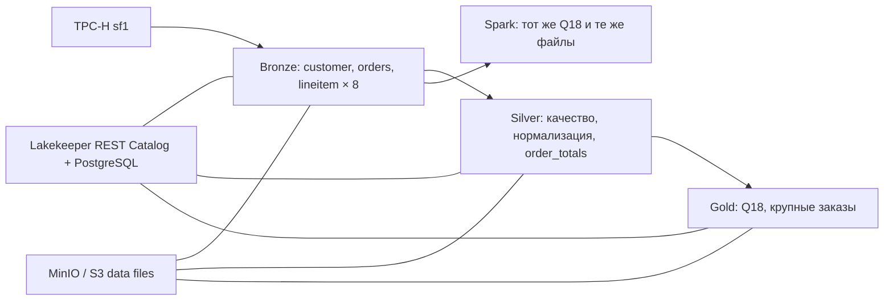

# Практическая работа №1 · вариант 3 · TPC-H Q18

Воднев Даниил Евгеньевич, БИВТ-24-АЭ-3.

Это адаптация предоставленного готового проекта Lakehouse под Q18 «Large Volume
Customer». Сохранены медальонная архитектура и сравнение Parquet/ORC с четырьмя
кодеками. Добавлены Spark, сверка результатов и рабочие демонстрации Iceberg.

**Основной документ для проверки:** [отчет.md](отчет.md), заполненный по форме
преподавателя. Результаты бенчмарка находятся в [results/benchmark.csv](results/benchmark.csv).
Происхождение проекта и список изменений: [PROVENANCE.md](PROVENANCE.md).

## Что сделано

- Локальные MinIO/Silo, PostgreSQL, Lakekeeper, Trino и Spark в Docker.
- sf1: customer 150 000, orders 1 500 000, lineitem 6 001 215 строк.
- Bronze: исходные данные и 8 сочетаний формата/кодека.
- Silver: качество, нормализация, DECIMAL, обогащение и суммы по заказам.
- Gold: крупные заказы, результат Q18 в [gold_q18.csv](results/gold_q18.csv).
- Одна измеренная запись для каждого сочетания и три пары чтений Trino.
- Первый запрос Spark и три повторных для каждого сочетания, без table cache.
- Сравнение каждого успешного Q18 и Gold с эталоном TPC-H.
- ADD/RENAME колонки, чтение исторического снимка и rollback с проверкой.



## Запуск

Нужны Docker с Compose, Python **3.12 или новее** и около 7 ГБ свободного места для образов,
данных и временных файлов. Набор данных не вложен в репозиторий: он генерируется
детерминированно командой CTAS из TPC-H-коннектора. В Git входят код и результаты,
а data files и metadata PostgreSQL сохраняются в Docker volumes.

На Mac использован отдельный профиль Colima `lakehouse`, VZ, arm64, 3 CPU и 4 ГиБ.
При работающем Docker Desktop на Linux/Windows/macOS достаточно:

```bash
bash run_all.sh
```

Для Mac с Colima (`brew install colima docker docker-compose`, Python 3.12):

```bash
bash start_mac.sh
```

Можно указать другой Python 3.12: `PYTHON_EXEC=/path/to/python3 bash start_mac.sh`.
Скрипт использует отдельную конфигурацию Docker без credential helper Desktop и
не меняет активный Docker context. Это обход локально отсутствующего клиента
`docker-credential-desktop`, а не изменение учётных данных Docker.

### По шагам

```bash
python3 -m venv .venv
.venv/bin/python -m pip install -r requirements.txt
.venv/bin/python setup.py
.venv/bin/python pipeline.py bronze
.venv/bin/python bench_codecs.py --repeats 3
.venv/bin/python verify_files.py
.venv/bin/python pipeline.py silver-gold
.venv/bin/python pipeline.py demo
.venv/bin/python run_spark.py
.venv/bin/python record_environment.py
.venv/bin/python build_report.py
```

Для существующего Colima-профиля перед командами укажите:

```bash
export DOCKER_HOST="unix://$HOME/.colima/lakehouse/docker.sock"
```

`bench_codecs.py` сохраняет результат после CTAS и после каждой пары чтений.
При повторном запуске он продолжает недостающие сочетания/повторы, не выдавая
существующую таблицу за новую запись. `run_spark.py` аналогично пропускает готовые
JSON. Поэтому результаты в репозитории воспроизводимы кодом, а повторный запуск
с ними предназначен для восстановления стенда/продолжения, не для нового полного
эксперимента. Чтобы заново измерить только чтения одной таблицы:

```bash
.venv/bin/python bench_codecs.py --only parquet_none --refresh-reads
```

Для полностью нового эксперимента используйте копию проекта с новым Compose
project name и пустой папкой `results`; исходные результаты сохраните отдельно.
Все сервисы, сети и тома имеют префикс `vodnev-lakehouse`. Скрипты не удаляют
посторонние контейнеры или тома.

## Просмотр и остановка

После выполненного прогона стенд остановлен для освобождения памяти Mac; таблицы
сохранены в Colima. Восстановить именно этот уже заполненный стенд без новых
измерений и установки Python-пакетов:

```bash
bash resume_mac.sh
```

Сохранённый `results/docker-ps.txt` показывает состояние на окончании измерений,
до остановки. Он служит подтверждением развёртывания, а не текущим индикатором.

| Сервис | Адрес |
|---|---|
| MinIO Console | [localhost:19001](http://localhost:19001), minioadmin / minioadmin |
| Lakekeeper UI | [localhost:18181/ui](http://localhost:18181/ui/) |
| Trino UI | [localhost:18080](http://localhost:18080) |

```bash
docker compose ps
docker compose stop
docker compose start
```

Для Colima также можно остановить всю виртуальную машину:
`colima stop lakehouse`. Данные при остановке сохраняются. Учебные пароли и
отсутствие авторизации допустимы только для этого стенда на localhost.

## Файлы и доказательства

| Файл | Назначение |
|---|---|
| compose.yaml, catalog/, warehouses/, trino/ | Конфигурация стенда |
| setup.py | Создание бакетов и регистрация warehouse |
| sql/1_bronze.sql → 2_silver.sql → 3_gold.sql | Полный ELT |
| bench_codecs.py | Реальные CTAS и Q18, три пары чтений Trino |
| spark_bench.py, run_spark.py | Чтение тех же Bronze-таблиц в Spark |
| pipeline.py demo | Schema evolution, time travel и rollback |
| results/queries.jsonl | SQL, время UTC, query ID и hash успешных результатов |
| results/trino_*.json, spark_*.json | Исходные замеры и планы Spark |
| results/benchmark.csv | Сводка, включая последний столбец Spark |
| results/data_quality.json, inventory.json, iceberg_demo.json | Проверки слоёв и Iceberg |
| draw_charts.py, build_report.py, img/ | Графики и отчёт по фактическим результатам |

Ни один набор чисел из примера не перенесён в собственные результаты.
Первое чтение после рестарта не означает очистку page cache ОС. Запись измерена
один раз; медианы применяются к чтению. Успешный запуск готовой таблицы не является
повторной записью. Методология и ограничения подробно изложены в отчёте.

## Сдача

Папку проекта можно публиковать как Git-репозиторий под собственной учётной
записью. По форме преподавателя в отчёте должен быть указан вариант и ФИО для
идентификации. Большие jar, Docker volumes и Python-окружение исключены из Git;
Iceberg jar автоматически загружаются скриптом из Maven Central.
