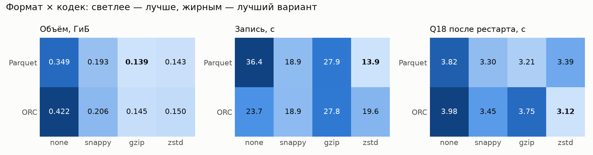
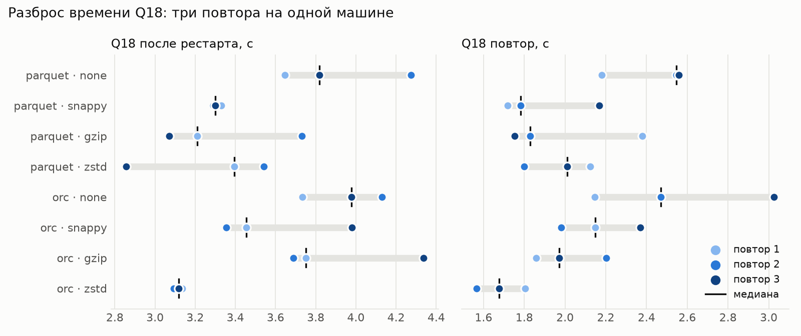
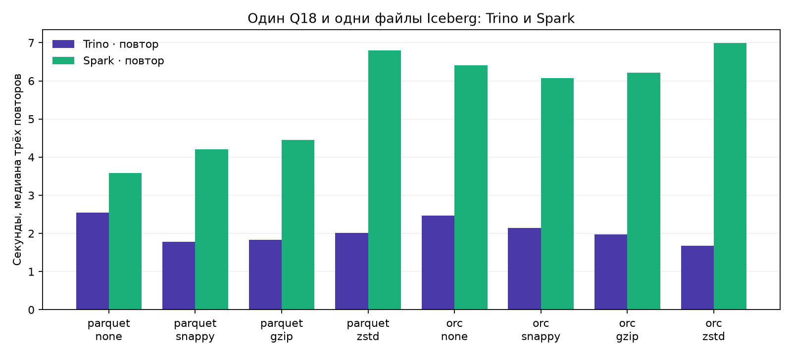

# Отчёт по практической работе №1

**Развертывание локального Lakehouse, ELT-преобразование и бенчмарк форматов/сжатия**

Воднев Даниил Евгеньевич · БИВТ-24-АЭ-3 · вариант 3 · 12 октября 2026 года

## 1. Вариант и масштаб

| Поле | Значение |
|---|---|
| ФИО | Воднев Даниил Евгеньевич |
| Имя в таблице распределения вариантов | Воднев Даниил |
| Группа | БИВТ-24-АЭ-3 |
| Вариант (запрос) | 3, TPC-H Q18 «Large Volume Customer» |
| Масштаб | `sf1`: customer 150 000, orders 1 500 000, lineitem 6 001 215 строк |
| Почему выбрал такой масштаб | Это уже миллионы строк и заметные различия размера файлов, но объём помещается на ноутбуке с 8 ГБ памяти. Для всех сочетаний формата и кодека используются одни данные sf1. |

Нужно найти заказы с суммой `quantity > 300`, присоединить клиента и вывести до 100
заказов по убыванию стоимости и затем по дате. На sf1 подходящих заказов **57**,
поэтому это корректное число строк при `LIMIT 100`. Источник — детерминированный
TPC-H-коннектор Trino, который генерирует строки, а не читает внешние CSV.
Отрасль — оптовая торговля: витрина помогает выделить крупные заказы и клиентов.

## 2. Поднятые сервисы — и почему именно они

| Сервис | Роль в стеке | Почему именно он |
|---|---|---|
| MinIO / Silo `RELEASE.2026-09-03T13-18-01Z` | S3-совместимое объектное хранилище | Один локальный сервис для файлов обоих движков. Silo — поддерживаемый форк MinIO, использованный в официальном примере Lakekeeper. |
| PostgreSQL 17 | Метаданные каталога Lakekeeper | Транзакционная БД для состояния каталога, поддерживается Lakekeeper. Аналитические строки лежат в S3, а не в PostgreSQL. |
| Lakekeeper 0.14.0 | Iceberg REST Catalog | Один открытый каталог позволяет Trino и Spark читать те же таблицы, не создавая отдельные копии для каждого движка. |
| Trino 476 | SQL, генерация TPC-H, CTAS и ELT | Есть TPC-H и Iceberg-коннекторы. Формат и кодек можно менять одной настройкой сессии, сохраняя SQL запроса. |
| Apache Spark 3.5.7 + Iceberg 1.10.1 | Дополнительный движок и сравнение Q18 | Читает те же Bronze-таблицы через REST Catalog и S3FileIO. Подходит для пакетных преобразований; здесь проверяется совместимость и время агрегации. |

Фактическое состояние контейнеров: [results/docker-ps.txt](results/docker-ps.txt).
Версии, digest образов и ресурсы записаны в [results/environment.json](results/environment.json).
Стенд: Apple Silicon arm64, 8 CPU / 8 ГБ на хосте; Colima VZ — **3 vCPU / 4 ГиБ**.
Trino — один координатор, который также является worker, heap 1536 МиБ, лимит
контейнера 2400 МиБ. Spark — `local[2]`, driver 1 ГиБ, 8 shuffle partitions.
Движки измеряются последовательно: во время Spark Trino остановлен.

### Скрипты, которыми поднят стек

```bash
colima start lakehouse --cpu 3 --memory 4 --disk 12 --root-disk 10 --vm-type vz --activate=false
export DOCKER_HOST="unix://$HOME/.colima/lakehouse/docker.sock"
python setup.py
```

`setup.py` выполняет Docker Compose из [compose.yaml](compose.yaml): запускает
PostgreSQL и MinIO, создаёт бакеты, применяет миграции Lakekeeper, регистрирует
warehouse `bronze`, `silver`, `gold` и запускает Trino и контейнер Spark.
Повторный запуск не удаляет данные. Для нового полного бенчмарка нужен отдельный
проект/тома или явная очистка собственных результатов и таблиц: сохранённые CTAS
не выдаются за повторные записи.

| Что открыть | Адрес |
|---|---|
| MinIO Console | http://localhost:19001 (minioadmin / minioadmin) |
| Lakekeeper UI | http://localhost:18181/ui/ |
| Trino UI | http://localhost:18080 |

Сервисы доступны только с localhost; эти учебные настройки не рассчитаны на публичный сервер.

## 3. Разбор запроса — какие данные нужны

| Таблица TPC-H | Нужные колонки Q18 | Что запрос с ними делает |
|---|---|---|
| customer | custkey, name | JOIN с orders по custkey, GROUP BY и вывод клиента |
| orders | orderkey, custkey, orderdate, totalprice | JOIN с customer/lineitem, группировка, стоимость и дата в выводе, ORDER BY |
| lineitem | orderkey, quantity | SUM(quantity) по заказу, HAVING > 300, JOIN по orderkey, сумма в выводе |

Дополнительно `mktsegment` и `orderstatus` нужны для нормализации в Silver,
`extendedprice`, `discount`, `shipdate` и `linenumber` — для проверки качества и
обогащения фактов. Сырой lineitem сохранён целиком, как в предоставленном примере,
чтобы сравнивать физическое хранение широкой таблицы. Q18 читает только нужные
колонки: размер всей таблицы не равен объёму, прочитанному запросом.

## 4. Медальон — решения по каждому слою

Размер — сумма `file_size_in_bytes` текущих data files из Iceberg `$files`, **МиБ =
2²⁰ байт**. Он не включает PostgreSQL, манифесты, историю и все бакеты целиком.
Счётчики строк получены через `count(*)`; схемы и свойства сохранены в
[results/inventory.json](results/inventory.json).

### Bronze (сырой)

| Таблица | Колонки (что оставил) | Строк | Вес, МиБ | Формат | Сжатие | Партиционирование | Обоснование |
|---|---|---|---|---|---|---|---|
| `bronze.raw.customer` | custkey, name, mktsegment | 150 000 | 0.283 | PARQUET | ZSTD | нет | Компактный справочник для JOIN и имени клиента |
| `bronze.raw.orders` | orderkey, custkey, orderstatus, totalprice, orderdate | 1 500 000 | 13.111 | PARQUET | ZSTD | нет | Ключи, дата и стоимость заказа для Q18, статус для нормализации |
| `bronze.bench.lineitem_parquet_zstd` | orderkey, partkey, suppkey, linenumber, quantity, extendedprice, discount, tax, returnflag, linestatus, shipdate, commitdate, receiptdate, shipinstruct, shipmode, comment | 6 001 215 | 146.131 | PARQUET | ZSTD | нет | Полная сырая схема из примера, без преобразования значений |
| `bronze.bench.lineitem_parquet_none` | все 16 исходных колонок | 6 001 215 | 357.783 | PARQUET | NONE | нет | Контрольная копия для сравнения формата и кодека |
| `bronze.bench.lineitem_parquet_snappy` | все 16 исходных колонок | 6 001 215 | 197.228 | PARQUET | SNAPPY | нет | Контрольная копия для сравнения формата и кодека |
| `bronze.bench.lineitem_parquet_gzip` | все 16 исходных колонок | 6 001 215 | 142.597 | PARQUET | GZIP | нет | Контрольная копия для сравнения формата и кодека |
| `bronze.bench.lineitem_orc_none` | все 16 исходных колонок | 6 001 215 | 431.652 | ORC | NONE | нет | Контрольная копия для сравнения формата и кодека |
| `bronze.bench.lineitem_orc_snappy` | все 16 исходных колонок | 6 001 215 | 211.181 | ORC | SNAPPY | нет | Контрольная копия для сравнения формата и кодека |
| `bronze.bench.lineitem_orc_gzip` | все 16 исходных колонок | 6 001 215 | 148.601 | ORC | GZIP | нет | Контрольная копия для сравнения формата и кодека |
| `bronze.bench.lineitem_orc_zstd` | все 16 исходных колонок | 6 001 215 | 153.678 | ORC | ZSTD | нет | Контрольная копия для сравнения формата и кодека |

Bronze — исходные значения без очистки. Все восемь lineitem содержат одинаковые
6 001 215 строк и 16 колонок. Партиционирование отсутствует: Q18 не фильтрует дату,
а полная агрегация количества требует сканировать все заказы. При sf1 разбиение
по дате добавило бы небольшие файлы без полезного partition pruning.

### Silver (очищенный)

| Таблица | Колонки (что оставил) | Строк | Вес, МиБ | Формат | Сжатие | Партиционирование | Обоснование |
|---|---|---|---|---|---|---|---|
| `silver.core.dq_report` | source_rows, invalid_quantity, invalid_price, invalid_discount, missing_order, missing_customer, invalid_shipdate | 1 | 0.001 | PARQUET | ZSTD | нет | Один результат проверки всего исходного набора |
| `silver.core.dim_customer` | custkey, name, market_segment | 150 000 | 0.286 | PARQUET | ZSTD | нет | TRIM имени и единый регистр сегмента |
| `silver.core.orders` | orderkey, custkey, order_status, totalprice, orderdate | 1 500 000 | 12.466 | PARQUET | ZSTD | нет | Ключи, дата и стоимость заказа для Q18, статус для нормализации |
| `silver.core.fact_lineitem` | orderkey, linenumber, quantity, gross_amount, discount, net_amount, custkey, orderdate, order_year | 6 001 215 | 68.372 | PARQUET | ZSTD | нет | Проверенные строки, денежные DECIMAL и рассчитанный net_amount |
| `silver.core.order_totals` | orderkey, total_quantity, item_count, net_amount | 1 500 000 | 10.261 | PARQUET | ZSTD | нет | Количество товаров и сумма заказа, чтобы не группировать 6 млн строк в Gold |

Преобразования в [sql/2_silver.sql](sql/2_silver.sql): положительное количество,
неотрицательная цена, скидка в [0,1], существующие заказ и клиент, отгрузка не раньше
заказа; `TRIM` имени и `UPPER` кодов; суммы приведены к DECIMAL. Добавлены custkey,
дата и год заказа, `net_amount = extendedprice × (1 − discount)`. `order_totals`
агрегирует количество, число позиций и чистую сумму по каждому заказу.

**Фактическая проверка качества:** {"source_rows": 6001215, "invalid_quantity": 0, "invalid_price": 0, "invalid_discount": 0, "missing_order": 0, "missing_customer": 0, "invalid_shipdate": 0}.
Нулевые ошибки объясняются согласованным генератором TPC-H, поэтому очистка не
уменьшила число строк. Денежные расчёты выполняются в DECIMAL, чтобы не накапливать
погрешность суммирования double. В Silver/Gold выбран Parquet + ZSTD как компромисс
объёма и записи; измеренное преимущество по каждой метрике отдельно показано ниже.

### Gold (витрина)

| Таблица | Колонки (что оставил) | Строк | Вес, МиБ | Формат | Сжатие | Партиционирование | Обоснование |
|---|---|---|---|---|---|---|---|
| `gold.mart.large_volume_customer` | name, custkey, orderkey, orderdate, totalprice, total_quantity | 57 | 0.002 | PARQUET | ZSTD | нет | Готовый ответ Q18, малый объём для бизнес-аналитики |

Витрина `large_volume_customer` — результат Q18 поверх очищенных и предварительно
агрегированных данных. Сортировать нужно при чтении: физический порядок строк
CTAS не является гарантией `ORDER BY`. Первые пять заказов:

| name | custkey | orderkey | orderdate | totalprice | total_quantity |
|---|---|---|---|---|---|
| Customer#000128120 | 128120 | 4722021 | 1994-04-07 | 544089.09 | 323.00 |
| Customer#000144617 | 144617 | 3043270 | 1997-02-12 | 530604.44 | 317.00 |
| Customer#000013940 | 13940 | 2232932 | 1997-04-13 | 522720.61 | 304.00 |
| Customer#000066790 | 66790 | 2199712 | 1996-09-30 | 515531.82 | 327.00 |
| Customer#000046435 | 46435 | 4745607 | 1997-07-03 | 508047.99 | 309.00 |

Проверка: полный набор Gold совпал с прямым Q18 по `tpch.sf1.*`, включая имя,
ключи, дату, стоимость и количество. SHA-256 канонического результата:
`e539f1cadf0f130d11445dfe2018f1a843d45562b57cb848b43c6b454e43137c`. Результат: [CSV](results/gold_q18.csv).

## 5. Тесты производительности

### Методология

1. Данные sf1 одинаковы во всех вариантах. Меняется формат CTAS и свойство
   сессии `bronze.compression_codec`, которое проверяется через `SHOW SESSION`.
2. Для каждой комбинации выполнена **одна** измеренная полная запись `lineitem`.
   Время записи включает генерацию TPC-H, кодирование, сжатие, S3 и commit Iceberg;
   это время CTAS, а не только работа кодека. Запись не имеет трёх повторов.
3. Для чтения выполнены **три пары** Q18: после рестарта Trino и MinIO, затем
   сразу повторный запрос. Готовность проверяется маленьким запросом к TPC-H,
   который не читает файлы Bronze. В таблице — медиана трёх измерений.
4. Время — клиентский `perf_counter()` от execute/sql до полного fetchall/collect.
   Для Spark каждый вариант запускается в новом JVM: первый Q18 и три повторных;
   создание SparkSession/JVM вне таймера. DataFrame/table cache не используется.
5. Trino и Spark используют **одни файлы Iceberg**, один каталог и один Q18.
   Каждое успешное чтение сверено с эталоном по полному набору строк и SHA-256.
   SQL, время и query ID Trino: [queries.jsonl](results/queries.jsonl).

«После рестарта» означает холодное состояние процесса и метаданных движка.
Страничный кэш Linux VM и macOS не очищается, поэтому это **не физически холодный
диск**. Spark и Trino имеют разные оптимизаторы и планы, а на sf1 время планирования
и JIT заметно влияет на первый запрос. Фоновая нагрузка ноутбука и однократная
запись ограничивают выводы; разницу в доли секунды нельзя объявлять универсальным
преимуществом кодека. Неуспешные попытки запуска/готовности в медиану не входят.
Лимиты памяти и параллелизм движков выбраны под ноутбук и различаются, поэтому
таблица показывает их работу при указанных настройках, а не превосходство одного
движка при одинаковых вычислительных ресурсах.

### Полная таблица форматов, кодеков и движков

| Формат | Кодек | lineitem, ГиБ | Файлов | Запись CTAS, с | Trino после рестарта, с | Trino повтор, с | Масштаб | Spark первый Q18, с | Spark повтор, с |
|---|---|---|---|---|---|---|---|---|---|
| PARQUET | NONE | 0.349 | 4 | 36.37 | 3.819 | 2.547 | sf1 | 9.287 | 3.579 |
| PARQUET | SNAPPY | 0.193 | 4 | 18.86 | 3.300 | 1.782 | sf1 | 9.310 | 4.205 |
| PARQUET | GZIP | 0.139 | 4 | 27.88 | 3.210 | 1.829 | sf1 | 9.999 | 4.446 |
| PARQUET | ZSTD | 0.143 | 4 | 13.91 | 3.394 | 2.010 | sf1 | 9.023 | 6.792 |
| ORC | NONE | 0.422 | 4 | 23.74 | 3.979 | 2.471 | sf1 | 13.283 | 6.407 |
| ORC | SNAPPY | 0.206 | 4 | 18.94 | 3.454 | 2.147 | sf1 | 10.538 | 6.078 |
| ORC | GZIP | 0.145 | 4 | 27.79 | 3.750 | 1.971 | sf1 | 13.707 | 6.217 |
| ORC | ZSTD | 0.150 | 4 | 19.55 | 3.118 | 1.676 | sf1 | 10.762 | 6.995 |

Последняя колонка Spark заполнена реальными измерениями: медиана трёх повторов.
Для ORC `GZIP` соответствует ZLIB-сжатию потоков ORC, а для Parquet — GZIP.
Размер здесь относится только к изменяемому lineitem. Общий Bronze одного варианта
включает также общие `customer` и `orders`; хранение всех восьми копий — отдельный
экспериментальный расход.

### Обязательное сравнение GZIP и ZSTD на Bronze

| Сжатие на Bronze (Parquet) | Время Q18 Trino, повтор | Размер Bronze, МиБ | Наблюдение |
|---|---|---|---|
| GZIP | 1.829 с (медиана 3) | 155.991 | lineitem 142.597 МиБ, запись 27.88 с |
| ZSTD | 2.010 с (медиана 3) | 159.525 | lineitem 146.131 МиБ, запись 13.91 с |

Самый компактный вариант: **PARQUET + GZIP**
(142.60 МиБ). Самый быстрый повторный Q18 Trino по медиане:
**ORC + ZSTD** (1.676 с).
Parquet + ZSTD занимает на **59.2%** меньше
несжатого Parquet. По сравнению с Parquet + GZIP его размер отличается на
**+2.5%**, а запись занимает
13.91 с против 27.88 с. Здесь выбираю ZSTD для
регулярного ELT, сохраняя GZIP как кандидат на максимально компактное хранение;
вывод основан на этом наборе, а не на чужом стенде.

В Spark самая низкая медиана повторного Q18 получена для
**PARQUET + NONE**
(3.579 с). Размер всей таблицы не объясняет это
ранжирование сам по себе: Q18 использует только orderkey и quantity из lineitem,
а исполнение включает JOIN, shuffle и группировку. Разброс Spark заметен:
у Parquet + ZSTD повторы заняли 4.102–9.800 с,
поэтому его медиану 6.792 с следует оценивать вместе с диапазоном.





Физические кодеки проверены чтением footer каждого файла через PyArrow и S3:
[physical_files.json](results/physical_files.json). Для каждого файла совпали
ожидаемый кодек и число строк из Iceberg-манифеста.

Подробные числа и повторы: [benchmark.csv](results/benchmark.csv),
`trino_*.json`, `spark_*.json`; журналы Spark — `spark_*.log`.
В `$manifests` измерен объём манифестов, а не всех метаданных Iceberg; он сохранён
отдельно в CSV, и не прибавляется к размеру data files без пояснения.

## 6. Часть 2 — осмысление и работа с инструментами

### 6.1. Понять и объяснить

| Вопрос | Ответ |
|---|---|
| Зачем нужны большие данные и lakehouse? | Когда история и сырые данные растут, удобно хранить их в недорогом объектном хранилище и подключать разные вычислительные движки. Iceberg добавляет схему, атомарные изменения и снимки к файлам. Для небольшой операционной системы обычная БД проще; преимущество lakehouse здесь показано совместным чтением Trino и Spark и независимостью хранения от процессов. |
| Schema evolution на Silver | В учебной копии `silver.core.customer_demo` к custkey/name добавлена classification VARCHAR и переименована в customer_tier. Старые строки читаются, значение нового поля NULL. Это изменение метаданных, для ADD/RENAME переписывать исходные data files не понадобилось. Основная витрина не менялась. |
| Восстановление из снимка | Сначала сохранён ID снимка, затем изменено имя первого клиента. Старое имя прочитано через FOR VERSION AS OF. rollback_to_snapshot вернул текущие данные к исходному состоянию; Python assert проверил равенство всех трёх строк. Откат данных не отменяет изменение схемы. |

Фактический ID исходного снимка: `5721332390894574272`.
До изменения/после отката: `[[1, "Customer#000000001"], [2, "Customer#000000002"], [3, "Customer#000000003"]]`.
Изменённое состояние: `[[1, "TEMPORARY CHANGE"], [2, "Customer#000000002"], [3, "Customer#000000003"]]`.

```sql
ALTER TABLE silver.core.customer_demo ADD COLUMN classification VARCHAR;
ALTER TABLE silver.core.customer_demo RENAME COLUMN classification TO customer_tier;
-- snapshot_id берётся из customer_demo$snapshots ДО UPDATE
UPDATE silver.core.customer_demo SET name='TEMPORARY CHANGE', customer_tier='TEST' WHERE custkey=1;
SELECT custkey,name FROM silver.core.customer_demo FOR VERSION AS OF 5721332390894574272;
ALTER TABLE silver.core.customer_demo EXECUTE rollback_to_snapshot(5721332390894574272);
```

Скрипт: `python pipeline.py demo`. Схемы до/после, снимки и проверки:
[iceberg_demo.json](results/iceberg_demo.json). Указанный ID — из выполненного прогона;
при повторном создании таблицы скрипт получает новый ID автоматически.

### 6.2. Подключить инструмент к lakehouse

| Инструмент | Почему выбрал именно его |
|---|---|
| Apache Spark в Docker | Нужен второй вычислительный движок и отсутствующая в примере колонка бенчмарка. Spark напрямую читает Iceberg в Bronze через REST Catalog и S3FileIO, а PySpark позволяет выполнить SQL, собрать результат и сравнить его с Trino. |

Развёртывание Spark находится в `compose.yaml`. Подключение и действия в консоли:

```bash
python run_spark.py
```

Скрипт скачивает два официальных jar Iceberg 1.10.1 из Maven Central, останавливает
Trino на время измерений и для каждой из восьми таблиц выполняет `spark-submit`
с `--master local[2] --driver-memory 1g`. Параметры каталога:

```text
spark.sql.catalog.bronze=org.apache.iceberg.spark.SparkCatalog
spark.sql.catalog.bronze.type=rest
spark.sql.catalog.bronze.uri=http://lakekeeper:8181/catalog
spark.sql.catalog.bronze.warehouse=bronze
spark.sql.catalog.bronze.io-impl=org.apache.iceberg.aws.s3.S3FileIO
spark.sql.catalog.bronze.s3.endpoint=http://minio:9000
spark.sql.catalog.bronze.s3.path-style-access=true
```

`spark_bench.py` выполняет JOIN customer/orders/lineitem, SUM/HAVING и сортировку Q18
на Bronze. В собственных логах есть строки `MEASUREMENT` с временем, числом строк и
SHA-256; в JSON сохранён фактический план Spark. Все восемь сочетаний вернули
те же 57 заказов. Это взаимодействие с теми же Bronze-файлами, без
экспорта результатов из Trino и без отдельной генерации данных для Spark.

## 7. Выводы

Разделение Bronze, Silver и Gold позволило сохранить исходные значения, отдельно
проверить качество и получить небольшую витрину крупных заказов.
Parquet + ZSTD уменьшил размер lineitem на 59.2%
относительно несжатого Parquet и выбран для слоёв регулярной обработки.
По медиане повторного Q18 на этом стенде лучший результат получил
ORC + ZSTD, поэтому выводы о скорости нужно привязывать
к запросу, масштабу и движку.
Trino и Spark прочитали одни Iceberg-таблицы и дали одинаковый результат, а изменение
схемы и откат снимка показали возможности lakehouse поверх объектного хранилища.

Основа и источники: [PROVENANCE.md](PROVENANCE.md).
